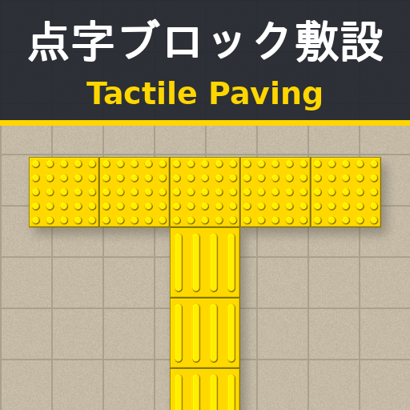

# Tactile Paving (点字ブロック敷設) — Cities: Skylines 1

Lay tactile paving (guide and warning blocks for visually impaired pedestrians) on road sidewalks, from a UnifiedUI (UUI) button.

道路の歩道上に点字ブロック（視覚障害者誘導用ブロック）を敷設できる Cities: Skylines 1 用のモッドです。UnifiedUI (UUI) のアイコンから使います。

## Features / 主な機能

- Guide blocks (bars) and warning blocks (dots), yellow or gray / 線状・点状ブロック × 黄色・グレー
- 1–3 rows wide (1 row = 300 mm) / 1〜3列（1列 = 300mm）
- Follows the sidewalk curve; nodes to continue or connect strips / 歩道のカーブに沿って敷設、ノードから続きを敷設
- Right-click removes blocks one by one; Ctrl+Z undoes the last strip / 右クリックで1枚ずつ削除、Ctrl+Z で取り消し
- Japanese / English, switched instantly in the options / 日本語・英語をオプション画面で即時切り替え
- Placed blocks are saved in the save game / 敷設したブロックはセーブデータに保存

Requires [UnifiedUI (UUI)](https://steamcommunity.com/sharedfiles/filedetails/?id=2255219025). Full usage: `Workshop/description-ja-en.txt`.

必要なもの: [UnifiedUI (UUI)](https://steamcommunity.com/sharedfiles/filedetails/?id=2255219025)。詳しい使い方は `Workshop/description-ja-en.txt` を参照してください。

## Build / ビルド

The game DLLs (`Assembly-CSharp.dll`, `ColossalManaged.dll`, `ICities.dll`, `UnityEngine.dll` from `Cities_Data/Managed`) are not part of this repository. Build against your own installed game.

ゲームの DLL（`Cities_Data/Managed` の `Assembly-CSharp.dll`, `ColossalManaged.dll`, `ICities.dll`, `UnityEngine.dll`）はリポジトリに含めていません。インストール済みのゲームを使ってビルドしてください。

- **Visual Studio / MSBuild**: open `TactilePaving.csproj` and build. The default game path is the standard Steam location; otherwise pass `/p:GameManaged=<path to Cities_Data\Managed\>`. The build copies `TactilePaving.dll`, `UnifiedUILib.dll` and `PreviewImage.png` to `%LOCALAPPDATA%\Colossal Order\Cities_Skylines\Addons\Mods\TactilePaving\`.
  標準の Steam の場所以外にインストールしている場合は `/p:GameManaged=<Cities_Data\Managed\ のパス>` を指定してください。ビルド後、上記のモッドフォルダへ自動でコピーされます。
- **Mono**: `./build.sh <path to Cities_Data/Managed>` → output in `bin/`.

`UnifiedUILib.dll` must be placed next to `TactilePaving.dll`. / `UnifiedUILib.dll` は必ず `TactilePaving.dll` と同じフォルダに置いてください。

## Source files / ファイル構成

| File | Role / 役割 |
| --- | --- |
| `ModMain.cs` | Mod entry and options / モッド情報とオプション画面 |
| `ModSettings.cs` | Saved settings / 設定値の保存 |
| `Localization.cs` | Japanese / English switching / 日本語・英語の切り替え |
| `LoadingExtension.cs` | Creates the tool on level load / 読み込み時にツールなどを作成 |
| `ToolButton.cs` | UUI button registration, backup button / UUI へのボタン登録と予備ボタン |
| `SettingsPanel.cs` | In-game settings panel / ゲーム内の設定パネル |
| `TactilePavingTool.cs` | The laying tool (clicks, preview) / 敷設ツール |
| `TactileGeometry.cs` | Sidewalk detection and paths / 歩道の判定と経路の計算 |
| `TactilePavingData.cs` | Placed blocks and save format / 敷設済みブロックと保存形式 |
| `TactilePavingRenderer.cs` | Rendering / 描画 |
| `TactileTextures.cs` | Generated textures and icon / テクスチャとアイコンの生成 |
| `TactileBlockType.cs` | Block types / ブロックの種類 |
| `SerializableDataExtension.cs` | Save / load / セーブデータへの保存・読み込み |
| `DeferredAction.cs` | Runs UI rebuilds on the next frame / UI の作り直しを次のフレームで実行 |

## License / ライセンス

MIT. See `LICENSE` and `THIRD-PARTY-NOTICES.md`.
